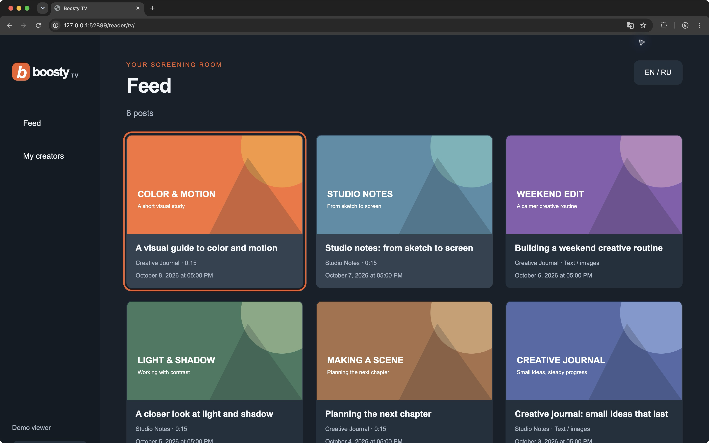
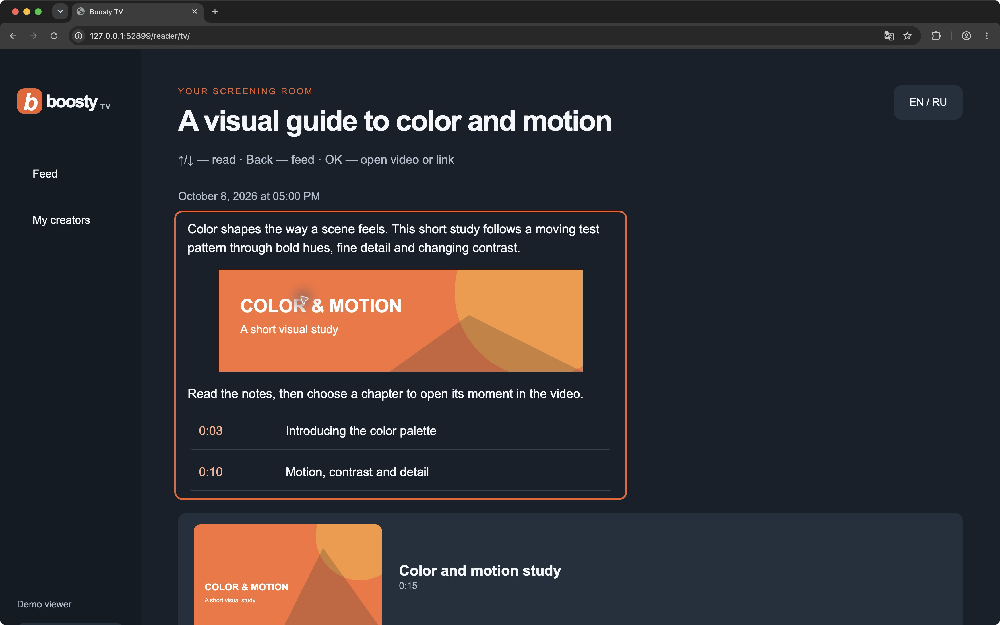
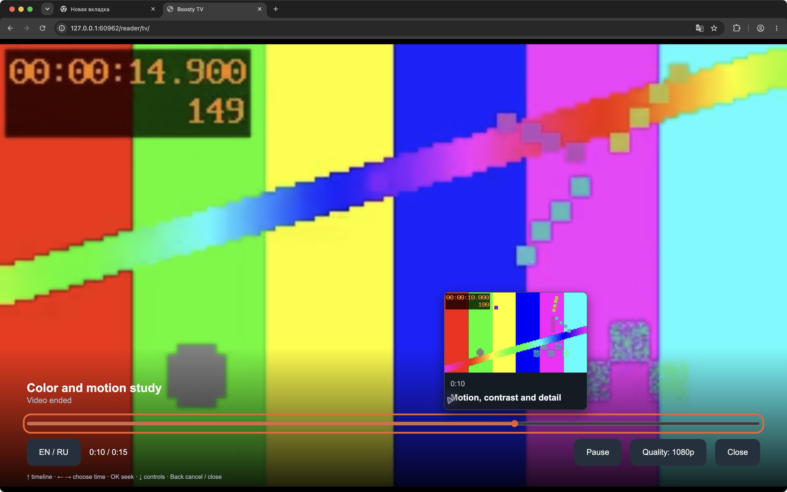
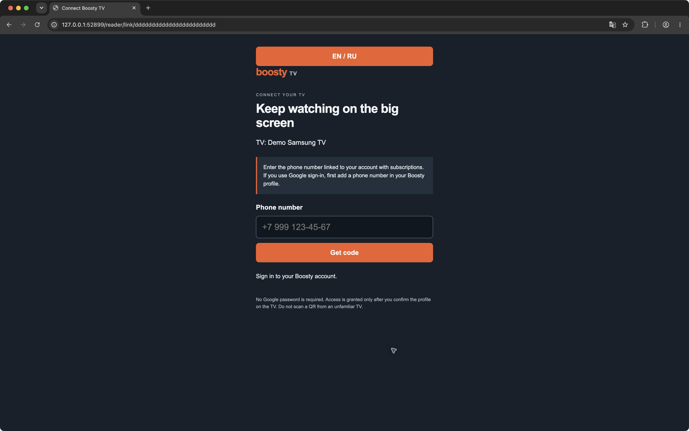
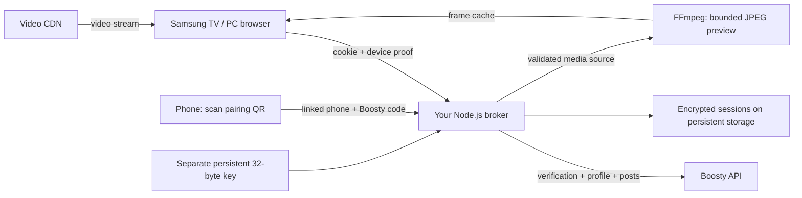

# Boosty for Samsung TV (Tizen)

English · [Русский](README.ru.md)

[](https://github.com/staners2/boosty-samsung-tv/actions/workflows/ci.yml)
[](LICENSE)

An unofficial, self-hosted Boosty client for Samsung Tizen TVs and PC browsers.
Read full posts with images and watch videos from your subscriptions using a TV
remote or mouse.

You need **your own HTTPS server** and a **Boosty account with a linked phone
number and access to the desired posts**. The app does not bypass subscriptions.

[PC browser](#source-development-and-pc-use) · [Docker Compose](#docker-compose) ·
[Samsung TV installation](#samsung-tv-installation) · [Kubernetes / Helm](#kubernetes--helm)



Navigate video chapters and select a timeline position with frame previews.
When a post contains timecoded chapter descriptions, the timeline also shows the
description for the selected position.

English is the first-run language. Use **EN / RU** in the main screen, player or
phone page. Your explicit choice is saved locally. Creator content is not translated.

## Screenshots

Captured from the built app in a desktop browser with fictional creators, posts
and a local test video. The phone connection page uses an inactive demo link and
empty fields. These screenshots show the browser interface; native Samsung TV
playback uses a separate player.

| Feed | Full post |
| --- | --- |
|  |  |
| Browse publications from your creators. | Read the full article and open a video chapter. |

| Player and frame preview | Phone connection |
| --- | --- |
|  |  |
| Select a timeline position before seeking. | Connect using the phone number linked to your Boosty account. |

## How it works



Phone verification is followed by profile confirmation on the TV. Boosty tokens
stay in the broker's AES-256-GCM vault, not browser localStorage. The browser
stores a device proof and language preference. Pairing URLs contain temporary
keys: do not share QR screenshots. Google passwords are never requested; Google
users must first link a phone number to the same Boosty account.

## Requirements

- Node.js 24+, npm and FFmpeg for a source installation.
- Docker with Compose, or Kubernetes with Helm and persistent RWO storage.
- Your own HTTPS hostname and trusted TLS certificate, reachable from TV/phone.
- A Boosty account with a linked phone number and access to the desired posts.
- For TV sideloading: Tizen Studio with TV/Web tools and your Samsung signing
  certificate. A PC browser needs no installer.

The app uses an unofficial upstream API; Boosty changes can affect compatibility.
Do not expose the broker without TLS. HTTP is accepted only for loopback development.

## Compatibility

| Platform | Requirement | Validation scope |
| --- | --- | --- |
| Samsung TV | Tizen 9.0+ is declared in [config.xml](tizen/config.xml) | Native AVPlay, codecs and remote controls need acceptance on the target TV for the current version. Older Tizen versions are not claimed supported. |
| PC browser | A modern desktop browser | Browser UI fixtures and demo screenshots cover navigation and player behavior. HLS and codec support vary by browser. |

## First setup: create the key once

Run from the project directory. This creates a private key directory and exactly
32 raw random bytes. An existing key causes an error, never an overwrite:

```sh
node --input-type=module -e 'import {mkdir,writeFile} from "node:fs/promises"; import {randomBytes} from "node:crypto"; await mkdir("secrets",{recursive:true,mode:0o700}); await writeFile("secrets/vault.key",randomBytes(32),{flag:"wx",mode:0o600});'
cp .env.example .env
```

Edit `.env`: set `PUBLIC_URL` to your HTTPS **origin only**, for example
`https://tv.example.org`. Set `BASE_PATH=/reader` if sharing a hostname;
otherwise leave it empty. Do not put a path, credentials, query or fragment in
PUBLIC_URL, and do not add a trailing slash to BASE_PATH.

**Back up the key and encrypted data separately.** Losing or replacing the key
makes saved sessions unreadable. Never commit `.env`, `secrets/`, data, signed
packages, certificates or signing profiles. Base64 is not key encryption.

## Docker Compose

```sh
docker compose build
```

The app runs as uid/gid 1000. Make only the mounted key readable by that identity
before startup (Linux/macOS Docker bind mounts; this changes that file's owner):

```sh
docker run --rm --user 0:0 --network none --mount "type=bind,src=$PWD/secrets/vault.key,dst=/key" --entrypoint sh boosty-tv:local -c 'chown 1000:1000 /key && chmod 400 /key'
docker compose up -d
docker compose ps
curl --fail http://127.0.0.1:8787/health
```

For BASE_PATH=/reader, use `/reader/health`. Keep the containing `secrets`
directory private; use appropriate host privileges for backups after ownership
changes. The one-shot data-init container initializes the **volume directory**
ownership; it does not generate a key or rewrite session files. The app has a
read-only root filesystem and writable /data and /tmp.

Compose binds the service to loopback. Put an HTTPS reverse proxy in front of it,
preserving the prefix (do not strip /reader), cookies, Origin and request headers.
For an existing TLS-enabled nginx server, the proxy location can be:

```nginx
location /reader/ {
    proxy_pass http://127.0.0.1:8787;
    proxy_set_header Host $host;
    proxy_set_header X-Forwarded-Proto https;
    proxy_set_header X-Forwarded-For $proxy_add_x_forwarded_for;
    proxy_read_timeout 60s;
    proxy_buffering off;
}
```

Use `location /` for an empty prefix. Configure DNS and the TLS certificate
separately. A TV/phone must use the HTTPS hostname, not the container's loopback URL.
Changing PUBLIC_URL/BASE_PATH needs a container recreation, **not an image rebuild**.
`BOOSTY_IMAGE=boosty-tv:local` is a local build name, not a published registry image.

## Runtime environment

| Variable | Source/default | Compose / Helm |
| --- | --- | --- |
| PUBLIC_URL | HTTPS origin; loopback HTTP for development | .env / config.publicUrl |
| BASE_PATH | Empty or one safe segment, e.g. /reader | .env / config.basePath |
| HOST | 127.0.0.1 for source runs | 0.0.0.0 in containers |
| PORT | 8787; integer 1–65535 | Fixed internal 8787 / service.targetPort |
| HTTP_PORT | Compose host port only, default 8787 | Does not change internal PORT |
| DATA_DIR | ./data | /data; persistent volume / PVC |
| STATIC_DIR | ./dist | /app/dist; built image assets |
| VAULT_KEY_FILE | Explicit key file required in production | Read-only /run/secrets/boosty/vault.key |
| NODE_ENV | Set production outside local development | production |
| BOOSTY_IMAGE | Compose image/build target | Helm image.repository + tag OR digest |

Hosted TV and phone config.js are generated from the runtime environment with
no-store caching. WGT configuration is build-time and must be rebuilt when its
broker address changes. Runtime environment contains no Boosty tokens.

## Kubernetes / Helm

Build and push the Dockerfile to **your own** registry; no public image or chart
repository is assumed. For example, choose your registry and version:

```sh
docker build -t registry.example.org/boosty-tv:0.1.0 .
docker push registry.example.org/boosty-tv:0.1.0
kubectl create namespace boosty-tv
kubectl -n boosty-tv create secret generic boosty-tv-key --from-file=vault.key=secrets/vault.key
```

After key ownership changes, run key-reading commands with appropriate host
privileges. For secret managers, provision the same 32 raw bytes into that Secret.
Do not put key bytes into Helm values or generate them during upgrades.

Create `values.local.yaml` with your actual hostname and registry:

```yaml
config:
  publicUrl: https://tv.example.org
  basePath: /reader
image:
  repository: registry.example.org/boosty-tv
  tag: "0.1.0"
  digest: ""
secrets:
  existingSecret: boosty-tv-key
  key: vault.key
persistence:
  size: 1Gi
  storageClass: ""
ingress:
  enabled: true
  hostname: tv.example.org
  className: nginx
  tls:
    - hosts: [tv.example.org]
      secretName: tv-tls
```

```sh
helm lint charts/boosty-tv -f values.local.yaml
helm template boosty-tv charts/boosty-tv -n boosty-tv -f values.local.yaml
helm upgrade --install boosty-tv charts/boosty-tv -n boosty-tv -f values.local.yaml
kubectl -n boosty-tv rollout status deployment/boosty-tv
```

The example expects an existing ingress controller and TLS Secret. Alternatively,
disable ingress and enable `route.enabled` with `route.hostname` and
`route.parentRefs` pointing to your existing HTTPS Gateway listener; Gateway API
CRDs must exist. Ingress and HTTPRoute are mutually exclusive and never strip the
prefix. The chart does not provision DNS, certificates, a Gateway or a secret manager.

For immutable images, leave tag empty and set digest to the real
`sha256:<64 lowercase hex digits>`. With private registries, set
`imagePullSecrets: [{name: registry-pull}]` and provision that Secret separately.
Use `persistence.existingClaim` to adopt an existing PVC; no new PVC is then created.
Chart-created PVCs have Helm keep and ArgoCD Prune=false/Delete=false annotations.
There is one replica with Recreate: **never add HPA or concurrent vault writers**.
For an existing Deployment, set fullnameOverride to its name and check selector
`app: <name>`, storage/key identities and backups before adopting it.

## Source development and PC use

```sh
npm ci --ignore-scripts
npm test
npm run build
npm start
```

npm start reads .env; exported environment values take precedence. It serves
`<PUBLIC_URL><BASE_PATH>/tv/` behind your proxy. For isolated local development,
override PUBLIC_URL=http://localhost:8787, NODE_ENV=development and an empty
BASE_PATH; never use loopback URLs in a real TV package. FFmpeg must be on PATH.

Open the hosted /tv/ URL in a PC browser, scan its QR on your phone, enter the
Boosty code, then confirm the profile on the PC. No executable or PC installer is
needed. Use arrows/OK/Back, or mouse controls. Focus the timeline, use ←/→ to select
time, then OK to seek; Back cancels selection. Browser HLS support varies; select
an available MP4 quality when needed. Files/external links open a phone QR;
post text, images, video and chapters render inside the app.
If the post contains timecoded descriptions for the playing video, selecting a
timeline position shows the corresponding chapter text.

## Samsung TV installation

Install Tizen Studio with TV/Web CLI and Samsung Certificate extensions.
Create your own Samsung certificate profile including the target TV's DUID.
Keep author certificates to sign future updates. See Samsung's
[SDK setup](https://developer.samsung.com/smarttv/develop/getting-started/setting-up-sdk/installing-tv-sdk.html) and
[certificate guide](https://developer.samsung.com/smarttv/develop/getting-started/setting-up-sdk/creating-certificates.html).

On the TV, open Apps → App Settings, enter 12345, enable Developer Mode, enter your
PC's LAN IP and reboot. TV and PC must share the network.
[Samsung device guide](https://developer.samsung.com/smarttv/develop/getting-started/using-sdk/tv-device.html).

Build for the **reachable HTTPS broker** and its prefix:

```sh
PUBLIC_URL=https://tv.example.org BASE_PATH=/reader npm run build
npm run package
```

dist/BoostyTV-unsigned.wgt is for inspection, **not installation**. Put your SDK
tools on PATH; set TIZEN_PROFILE to your own profile and TV_SERIAL to the
device serial from `sdb devices`. Use absolute packaging paths and rename the
signed file before installation: the SDK installer does not handle spaces in
the WGT filename.

```sh
sdb connect "$TV_SERIAL"
sdb devices
tizen package -t wgt -s "$TIZEN_PROFILE" -o "$PWD/dist" -- "$PWD/dist/wgt"
cp "$PWD/dist/Boosty TV.wgt" "$PWD/dist/BoostyTV.wgt"
tizen install -s "$TV_SERIAL" -n BoostyTV.wgt -- "$PWD/dist"
tizen run -s "$TV_SERIAL" -p BstTV00001.BoostyTV
```

In Device Manager, enable permission to install applications for this device.
CLI syntax and profile setup: [Samsung CLI guide](https://developer.samsung.com/smarttv/develop/getting-started/using-sdk/command-line-interface.html).
Do not publish signed WGTs, profiles, DUIDs or certificates. After launch, pair
by QR and confirm the profile. Physical-TV codec/remote/preview acceptance remains
a separate check; passing desktop tests does not prove every TV model works.

## Backups, upgrades and troubleshooting

Stop the writer before backing up encrypted session files; back up the unchanged
key separately with restricted access. Upgrade the image without replacing either.
Restore both matching key and vault together. Never use `docker compose down -v`
or delete the PVC to repair authentication. Key-read errors and decryption errors
fail startup rather than silently reset sessions.

- Interface not built: build dist, or use the complete Docker image.
- QR/network error: verify HTTPS trust, hostname reachability, prefix, proxy and
  `<BASE_PATH>/health`; do not remove Origin/device-proof checks.
- Sign-in/code error: use the phone linked to the subscribed account; delivery
  and upstream rate limits are controlled by Boosty.
- Missing previews: check FFmpeg, source availability and post access. HLS-only
  videos may lack previews; seeking still works. Preview selection shows a nearby
  cached frame honestly with its own timestamp while the exact frame loads.
- Key error: check raw length (32 bytes), mount and uid 1000 read permission.
  Decryption error: restore the matching key; do not generate a replacement.
- Tizen install error: check DUID, certificate, device permission and package
  requirement 9.0; do not distribute your certificate to other users.

## Validation and publication boundary

```sh
npm test
npm run build
npm run package
```

The suite includes FFmpeg frame decoding, browser/TV UI state, access control,
runtime config and Helm/Compose checks; install FFmpeg, Helm and Docker CLI for
the full suite. Docker daemon is needed for image/runtime checks, not Compose
configuration rendering. There are no production mock-login switches.

Source publication excludes dependencies, dist, vault data/keys, .env, signing
material and private deployment configuration. No private Git history is part
of this project. This is not an official Boosty or Samsung product, and it is not
a Samsung Store submission.

## Support and contributions

For a reproducible problem, use the [bug report form](https://github.com/staners2/boosty-samsung-tv/issues/new?template=bug_report.yml).
Include the TV model and Tizen version or browser version, app commit/tag, server
installation method, steps and sanitized errors. Never share tokens, cookies,
phone numbers, vault keys, signed media URLs or active pairing QR codes.

For a contribution, keep the change focused, run `npm test` and `npm run build`,
and describe the user-visible result and what you verified. TV-specific changes
should state whether they were tested on a physical Samsung TV.

## License

[MIT](LICENSE) · Copyright (c) 2026 staners2.
