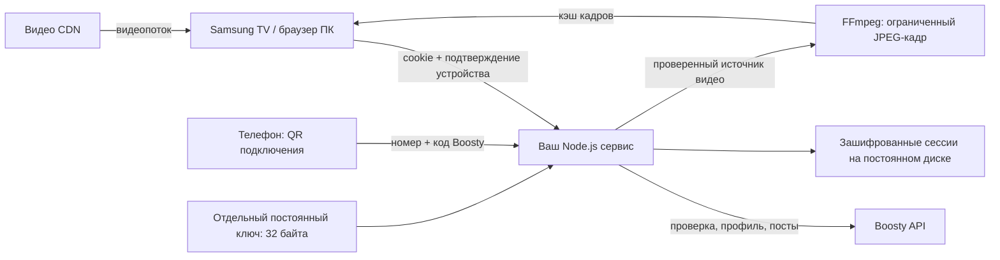

# Boosty for Samsung TV (Tizen)

Русский · [English](README.md)

[](https://github.com/staners2/boosty-samsung-tv/actions/workflows/ci.yml)
[](LICENSE)

Неофициальный клиент Boosty для Samsung Tizen TV и браузера ПК, работающий на
вашем сервере. Читайте полные посты с картинками и смотрите видео по подписке
с помощью пульта или мыши.

Нужны **собственный HTTPS-сервер** и **аккаунт Boosty с привязанным номером
телефона и доступом к нужным публикациям**. Приложение не обходит подписки.

[Просмотр на ПК](#исходники-и-просмотр-на-пк) · [Docker Compose](#docker-compose) ·
[Установка на Samsung TV](#установка-на-samsung-tv) · [Kubernetes / Helm](#kubernetes--helm)


Переходите к главам видео и выбирайте позицию на таймлайне с предпросмотром
кадра. Если в посте есть описания глав с таймкодами, при выборе позиции
отображается и соответствующее описание.

По умолчанию интерфейс английский. Кнопка **EN / RU** есть на главном экране,
в плеере и на странице телефона. Явный выбор сохраняется локально.
Контент авторов не переводится.

## Скриншоты

Снимки сделаны в браузере ПК из собранного приложения с вымышленными авторами,
публикациями и локальным тестовым видео. На странице подключения — неактивная
демонстрационная ссылка и пустые поля. Здесь показан браузерный интерфейс;
воспроизведение на Samsung TV использует отдельный нативный плеер.

| Лента | Полный пост |
| --- | --- |
|  |  |
| Просматривайте публикации своих авторов. | Читайте статью целиком и переходите к главам видео. |

| Плеер и предпросмотр кадра | Подключение с телефона |
| --- | --- |
|  |  |
| Выбирайте позицию на таймлайне перед перемоткой. | Используйте номер телефона, привязанный к вашему аккаунту Boosty. |

## Как это работает



После входа на телефоне профиль подтверждается на телевизоре. Токены Boosty
хранятся в AES-256-GCM хранилище сервиса, не в localStorage браузера. Браузер
сохраняет подтверждение устройства и язык. QR содержит временный ключ:
не публикуйте его скриншоты. Пароль Google не нужен; для такого аккаунта
сначала привяжите номер телефона в том же профиле Boosty.

## Требования

- Node.js 24+, npm и FFmpeg для запуска из исходников.
- Docker Compose либо Kubernetes с Helm и постоянным RWO-хранилищем.
- Собственный HTTPS-домен с доверенным TLS-сертификатом, доступный ТВ и телефону.
- Аккаунт Boosty с привязанным номером и доступом к нужным публикациям.
- Для установки на ТВ: Tizen Studio с TV/Web tools и ваш сертификат Samsung.
  Для браузера ПК отдельный установщик не нужен.

Используется неофициальный upstream API: изменения Boosty могут влиять на работу.
Не выставляйте сервис без TLS. HTTP разрешён только для локальной разработки
через loopback.

## Совместимость

| Платформа | Требование | Что проверяется |
| --- | --- | --- |
| Samsung TV | В [config.xml](tizen/config.xml) заявлен Tizen 9.0+ | Нативный AVPlay, кодеки и пульт требуют проверки текущей версии на целевом ТВ. Совместимость со старыми Tizen не заявлена. |
| Браузер ПК | Современный настольный браузер | Тесты UI с фикстурами и демонстрационные скриншоты охватывают навигацию и плеер. Поддержка HLS и кодеков зависит от браузера. |

## Первый запуск: создать ключ один раз

Из каталога проекта создайте приватную папку и ровно 32 случайных сырых байта.
Существующий ключ приводит к ошибке, а не к перезаписи:

```sh
node --input-type=module -e 'import {mkdir,writeFile} from "node:fs/promises"; import {randomBytes} from "node:crypto"; await mkdir("secrets",{recursive:true,mode:0o700}); await writeFile("secrets/vault.key",randomBytes(32),{flag:"wx",mode:0o600});'
cp .env.example .env
```

В .env задайте PUBLIC_URL как HTTPS **origin без пути**, например
https://tv.example.org. При совместном использовании домена задайте
BASE_PATH=/reader; иначе оставьте пустым. PUBLIC_URL не должен содержать
логин, пароль, путь, query или fragment. У BASE_PATH нет завершающего слеша.

**Сохраняйте ключ и зашифрованные данные отдельно.** Потеря или замена ключа
делает сохранённые сессии нечитаемыми. Не коммитьте .env, secrets/, данные,
подписанные пакеты, сертификаты и профили подписи. Base64 не шифрует ключ.

## Docker Compose

```sh
docker compose build
```

Приложение работает с uid/gid 1000. Перед запуском сделайте **только этот ключ**
читаемым для данной учётной записи контейнера. Команда меняет владельца файла
в bind mount на Linux/macOS:

```sh
docker run --rm --user 0:0 --network none --mount "type=bind,src=$PWD/secrets/vault.key,dst=/key" --entrypoint sh boosty-tv:local -c 'chown 1000:1000 /key && chmod 400 /key'
docker compose up -d
docker compose ps
curl --fail http://127.0.0.1:8787/health
```

Для BASE_PATH=/reader проверяйте /reader/health. Папка secrets должна оставаться
приватной; после смены владельца для backup могут понадобиться права на хосте.
Одноразовый data-init настраивает владельца **каталога volume**, не создаёт ключ
и не переписывает сессии. Корневая ФС приложения read-only; /data и /tmp доступны
для записи.

Compose слушает только loopback. Перед ним нужен HTTPS reverse proxy,
сохраняющий префикс (не удалять /reader), cookies, Origin и заголовки запросов.
В существующем TLS server nginx можно использовать:

```nginx
location /reader/ {
    proxy_pass http://127.0.0.1:8787;
    proxy_set_header Host $host;
    proxy_set_header X-Forwarded-Proto https;
    proxy_set_header X-Forwarded-For $proxy_add_x_forwarded_for;
    proxy_read_timeout 60s;
    proxy_buffering off;
}
```

Для пустого префикса — location /. DNS и сертификат настраиваются отдельно.
ТВ/телефон обращаются к HTTPS-домену, не к loopback контейнера.
Изменение PUBLIC_URL/BASE_PATH требует пересоздания контейнера, **не пересборки
образа**. BOOSTY_IMAGE=boosty-tv:local — локальное имя сборки, не опубликованный образ.

## Переменные окружения

| Переменная | Исходники / значение по умолчанию | Compose / Helm |
| --- | --- | --- |
| PUBLIC_URL | HTTPS origin; loopback HTTP для разработки | .env / config.publicUrl |
| BASE_PATH | Пусто или один безопасный сегмент, например /reader | .env / config.basePath |
| HOST | 127.0.0.1 | 0.0.0.0 в контейнерах |
| PORT | 8787; целое 1–65535 | Внутренний 8787 / service.targetPort |
| HTTP_PORT | Только порт хоста Compose; 8787 | Не меняет внутренний PORT |
| DATA_DIR | ./data | /data; volume / PVC |
| STATIC_DIR | ./dist | /app/dist; файлы из образа |
| VAULT_KEY_FILE | В production обязателен явный путь | Read-only /run/secrets/boosty/vault.key |
| NODE_ENV | production вне локальной разработки | production |
| BOOSTY_IMAGE | Имя образа/сборки Compose | image.repository + tag ИЛИ digest в Helm |

Hosted config.js для ТВ и телефона формируется из окружения при запуске,
с Cache-Control: no-store. В WGT адрес фиксируется при сборке: при его изменении
нужно пересобрать пакет. В окружении нет токенов Boosty.

## Kubernetes / Helm

Соберите Dockerfile и отправьте образ в **свой** registry. Готовый публичный
registry образов или chart не предполагается. Пример с вашим адресом и версией:

```sh
docker build -t registry.example.org/boosty-tv:0.1.0 .
docker push registry.example.org/boosty-tv:0.1.0
kubectl create namespace boosty-tv
kubectl -n boosty-tv create secret generic boosty-tv-key --from-file=vault.key=secrets/vault.key
```

После смены владельца ключа выполняйте читающие его команды с нужными правами
хоста. Если используете secret manager, доставьте в этот Secret **те же 32 сырых
байта**. Не храните ключ в Helm values и не генерируйте его при обновлении.

Создайте values.local.yaml с вашим доменом и registry:

```yaml
config:
  publicUrl: https://tv.example.org
  basePath: /reader
image:
  repository: registry.example.org/boosty-tv
  tag: "0.1.0"
  digest: ""
secrets:
  existingSecret: boosty-tv-key
  key: vault.key
persistence:
  size: 1Gi
  storageClass: ""
ingress:
  enabled: true
  hostname: tv.example.org
  className: nginx
  tls:
    - hosts: [tv.example.org]
      secretName: tv-tls
```

```sh
helm lint charts/boosty-tv -f values.local.yaml
helm template boosty-tv charts/boosty-tv -n boosty-tv -f values.local.yaml
helm upgrade --install boosty-tv charts/boosty-tv -n boosty-tv -f values.local.yaml
kubectl -n boosty-tv rollout status deployment/boosty-tv
```

Пример ожидает готовые ingress controller и TLS Secret. Альтернатива: отключите
ingress и задайте route.enabled, route.hostname, route.parentRefs для своего
HTTPS listener существующего Gateway. Нужны Gateway API CRD. Ingress и HTTPRoute
взаимоисключающие; ни один не удаляет префикс. Chart не создаёт DNS, сертификат,
Gateway или secret manager.

Для неизменяемого образа оставьте tag пустым, задайте реальный digest
sha256:<64 строчные hex-цифры>. Для приватного registry используйте
imagePullSecrets: [{name: registry-pull}] и заранее создайте этот Secret.
persistence.existingClaim подключает существующий PVC, без создания нового.
У создаваемого PVC есть Helm keep и ArgoCD Prune=false/Delete=false.
Одна реплика и Recreate: **не добавляйте HPA или параллельные writer хранилища**.
При принятии существующего Deployment задайте fullnameOverride равным его имени,
проверьте selector app: <name>, совпадение PVC/ключа и backups.

## Исходники и просмотр на ПК

```sh
npm ci --ignore-scripts
npm test
npm run build
npm start
```

npm start читает .env; экспортированное окружение имеет приоритет. Через reverse
proxy открывается <PUBLIC_URL><BASE_PATH>/tv/. Для изолированной разработки
переопределите PUBLIC_URL=http://localhost:8787, NODE_ENV=development, BASE_PATH
оставьте пустым. Не используйте loopback-адрес в пакете реального ТВ.
FFmpeg должен быть в PATH.

Откройте hosted /tv/ в браузере ПК, отсканируйте QR телефоном, введите код Boosty
и подтвердите профиль на ПК. Отдельного исполняемого файла/установщика нет.
Работают стрелки/OK/Назад и мышь. На таймлайне ←/→ выбирают время, OK перематывает,
Назад отменяет выбор. Поддержка HLS зависит от браузера; выбирайте доступный MP4
при необходимости. Файлы и внешние ссылки открывают QR для телефона; текст,
изображения, видео и главы отображаются в приложении.
Если в посте есть описания с таймкодами для воспроизводимого видео, при выборе
позиции на таймлайне отображается текст соответствующей главы.

## Установка на Samsung TV

Нужны Tizen Studio, TV/Web CLI и Samsung Certificate extensions. Создайте свой
Samsung certificate profile с DUID телевизора; сохраните author certificate
для будущих обновлений. Официальные инструкции:
[SDK](https://developer.samsung.com/smarttv/develop/getting-started/setting-up-sdk/installing-tv-sdk.html),
[сертификаты](https://developer.samsung.com/smarttv/develop/getting-started/setting-up-sdk/creating-certificates.html).

На ТВ: Apps → App Settings → 12345 → Developer Mode On; укажите LAN IP компьютера
и перезагрузите ТВ. Оба устройства должны быть в одной сети.
[Инструкция Samsung](https://developer.samsung.com/smarttv/develop/getting-started/using-sdk/tv-device.html).

Соберите пакет с **доступным HTTPS-адресом** и префиксом:

```sh
PUBLIC_URL=https://tv.example.org BASE_PATH=/reader npm run build
npm run package
```

dist/BoostyTV-unsigned.wgt предназначен для проверки, **не для установки**.
Добавьте SDK tools в PATH. Задайте свой TIZEN_PROFILE и TV_SERIAL
(serial из sdb devices). Используйте абсолютные пути для packaging и
переименуйте подписанный файл: SDK installer не обрабатывает пробелы в имени WGT.

```sh
sdb connect "$TV_SERIAL"
sdb devices
tizen package -t wgt -s "$TIZEN_PROFILE" -o "$PWD/dist" -- "$PWD/dist/wgt"
cp "$PWD/dist/Boosty TV.wgt" "$PWD/dist/BoostyTV.wgt"
tizen install -s "$TV_SERIAL" -n BoostyTV.wgt -- "$PWD/dist"
tizen run -s "$TV_SERIAL" -p BstTV00001.BoostyTV
```

В Device Manager разрешите установку приложений для устройства.
[CLI и настройка профиля](https://developer.samsung.com/smarttv/develop/getting-started/using-sdk/command-line-interface.html).
Не публикуйте подписанные WGT, профили, DUID или сертификаты. После запуска войдите
через QR и подтвердите профиль. Кодеки, пульт и скорость кадров требуют отдельной
проверки на физическом ТВ; desktop-тесты не доказывают работу на каждой модели.

## Backup, обновления и диагностика

Остановите writer перед backup зашифрованных файлов сессий. Неизменный ключ
сохраните отдельно с ограниченными правами. Обновляйте образ, не заменяя данные
и ключ. Восстанавливайте их совпадающей парой. Не используйте docker compose down -v
и не удаляйте PVC для ремонта входа. Ошибки чтения ключа/расшифровки останавливают
запуск, а не сбрасывают сохранённые сессии.

- Интерфейс не собран: соберите dist либо используйте полный Docker-образ.
- Ошибка QR/сети: проверьте HTTPS, доступность домена, префикс, proxy и
  <BASE_PATH>/health. Не отключайте Origin/device-proof проверки.
- Ошибка входа/кода: используйте номер подписанного аккаунта; способ доставки
  и upstream rate limits определяет Boosty.
- Нет превью: проверьте FFmpeg, источник и доступ к посту. Для HLS-only превью
  может отсутствовать; перемотка продолжает работать. Пока точный кадр загружается,
  соседний кадр из кэша показывается с его настоящим временем.
- Ошибка ключа: проверьте 32 сырых байта, mount и чтение uid 1000.
  Ошибка расшифровки: восстановите правильный ключ, не создавайте новый.
- Ошибка установки Tizen: DUID, сертификат, разрешение устройства и требование
  9.0; не раздавайте свой сертификат другим пользователям.

## Проверки и граница публикации

```sh
npm test
npm run build
npm run package
```

Тесты проверяют FFmpeg, состояние UI браузера/ТВ, доступ, runtime config и
Helm/Compose. Для всего набора нужны FFmpeg, Helm и Docker CLI. Docker daemon
требуется для сборки/runtime-проверок, не для рендера Compose. Production-режимов
фиктивного входа нет.

В публикацию не входят зависимости, dist, ключи/данные, .env, подписи и частные
настройки развёртывания. История частного Git не переносится. Это не официальный
продукт Boosty/Samsung и не заявка в Samsung Store.

## Поддержка и участие

Для воспроизводимой ошибки заполните [форму сообщения](https://github.com/staners2/boosty-samsung-tv/issues/new?template=bug_report.yml).
Укажите модель ТВ и версию Tizen либо версию браузера, commit/tag приложения,
способ установки сервера, шаги и ошибки без чувствительных данных. Не публикуйте
токены, cookies, номера телефонов, ключи хранилища, подписанные ссылки на видео
или действующие QR-коды подключения.

Для изменений сохраняйте узкий объём задачи, выполняйте `npm test` и
`npm run build`, описывайте результат для пользователя и проведённые проверки.
Для изменений Samsung TV укажите, проверялись ли они на физическом телевизоре.

## Лицензия

[MIT](LICENSE) · Copyright (c) 2026 staners2.
